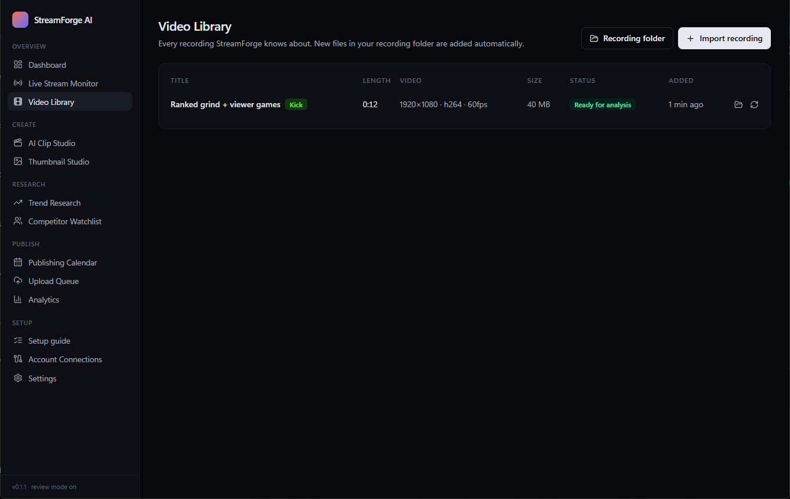
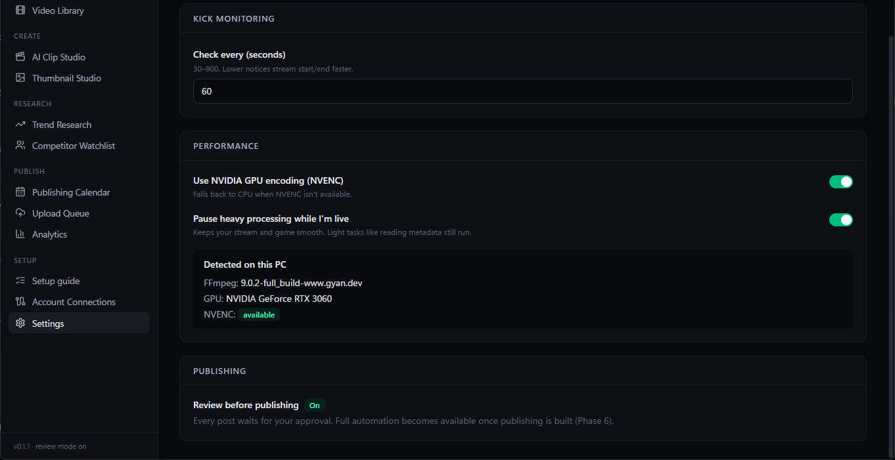

# StreamForge AI

**Stream on Kick, and StreamForge turns each broadcast into content: YouTube uploads, 60–120 s vertical clips with subtitles, thumbnails and posts for TikTok, Instagram and Facebook.**

A Windows desktop app built with Tauri 2, Rust, React, SQLite and FFmpeg.


> **Status: v0.2 preview.** The whole pipeline is in: live detection → recording import → transcription → best-moment detection → 60–120 s vertical clips with animated captions → thumbnails → review → YouTube and TikTok publishing → real analytics. Instagram and Facebook are waiting on Meta's developer registration. See the [roadmap](ROADMAP.md). Nothing in the app shows fake data.

## Download
**[⬇ Download the latest installer](https://github.com/Afaguayo/streamforge-ai/releases/latest)** (`StreamForge.AI_<version>_x64-setup.exe`, Windows 10/11, about 4 MB)

Then follow the **[setup guide](docs/SETUP.md)**. It takes about 10 minutes, and the app walks you through the same steps.

## What works today
| | |
|---|---|
| **Guided first-run setup** | A step-by-step checklist inside the app that ticks itself off as you go. |
| **AI clips** | Transcribes your stream on your GPU (whisper.cpp, Spanish + English), finds the moments with laughter, hype and loud reactions, and cuts 60–120 s clips that start and end on full sentences. Optional Claude rating reads the transcript to judge hook, context and replay value. |
| **Vertical editing** | 9:16 with a blurred fill or your webcam on top, animated word-by-word captions, an on-screen hook, loudness normalisation, NVENC encoding at low priority. |
| **Thumbnails** | Three 1280×720 concepts per stream from its strongest moments, plus vertical covers. |
| **Publishing** | YouTube (Shorts and full streams) and TikTok, review-first: drafts, scheduling, a drag-and-drop calendar, retries. |
| **Research + analytics** | Daily YouTube trend report for your keywords, a competitor watchlist, and your own views/likes over time, which also tune clip scoring. |
| **Kick live detection** | Sees when you go live and when you stop, through Kick's official API. |
| **Automatic recording import** | Watches your OBS recording folder, waits until the file is finished, matches it to the stream that just ended, and reads its length, resolution and codecs. |
| **One-click sign-in** | Kick, YouTube, TikTok and Facebook + Instagram. Your browser opens, you approve, and it stays connected; logins renew automatically. |
| **Crash-safe processing queue** | Jobs survive crashes and restarts and retry on their own; you can retry or cancel from the dashboard. |
| **Runs in the background** | Lives in the system tray, and can pause heavy work while you're live so your game and stream stay smooth. |
| **Secure by default** | Keys and logins are stored in Windows Credential Manager, never in files or logs. |

| Account connections | Video library |
|---|---|
|  |  |
| **Settings** | |
|  | |

## How it works
```
 You stream on Kick ──▶ StreamForge sees you go live / offline (Kick API)
 OBS saves the recording ──▶ StreamForge imports it when the file is finished
                              │
                              ▼
        processing queue ──▶ metadata ✓ ──▶ transcription ──▶ best moments ──▶ clips + subtitles
                                             (coming next)                         │
                                                                                   ▼
                                    you review ──▶ YouTube · Shorts · TikTok · Reels (coming)
```
Every post waits for your approval until you turn on full automation.

## Good to know
- **Why it needs your OBS recording:** Kick's public API has no way to download past broadcasts. Unofficial methods break without notice, so StreamForge doesn't rely on them, and your local recording is better quality anyway.
- **Why you create a developer app per platform:** Kick, Google, TikTok and Meta only allow uploads through an app registered to you. It's free and done once; the [setup guide](docs/SETUP.md) has every click.
- **Platform limits:**
  - **TikTok** and **YouTube** keep API uploads private until they review your app.
  - The **Facebook Reels** API only takes clips up to 90 seconds.
  - **Instagram** needs a Professional account.

## Build from source
Requires Node 20+, Rust (stable, MSVC), the Visual Studio C++ Build Tools, and WebView2 (built into Windows 11).
```
npm install
npm run app:dev              # run in development
npm run app:build            # release build + installer in src-tauri/target/release/bundle/nsis
npm test                     # frontend tests
cd src-tauri && cargo test   # backend tests
```
Architecture, conventions and the platform research are in [DEVELOPMENT.md](DEVELOPMENT.md).
