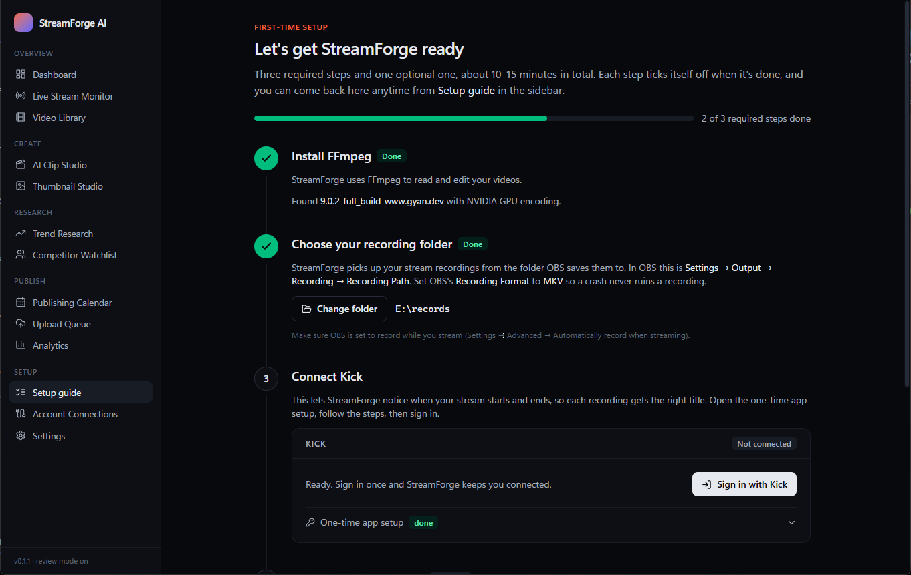
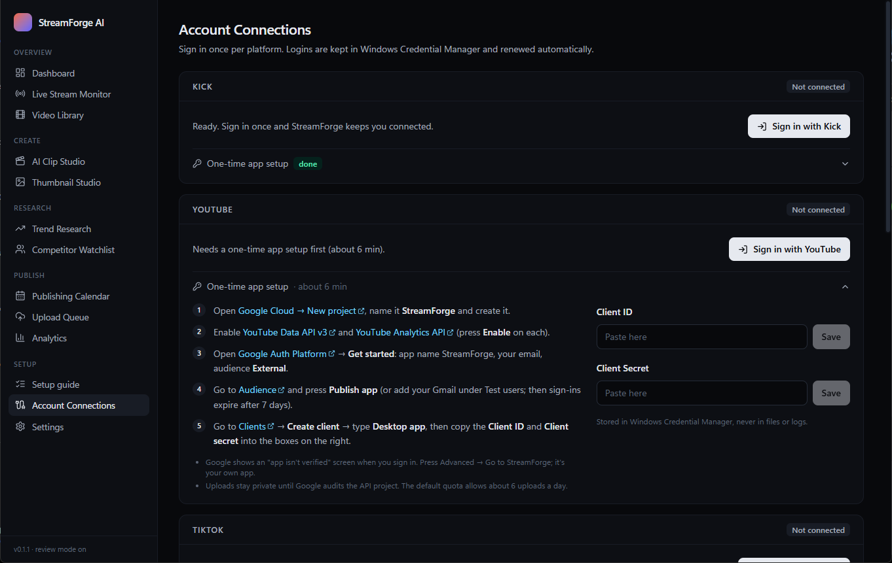

# Setup guide

This walks you through everything once, start to finish. Plan on **10–15 minutes** for the required part. The app has the same steps built in (**Setup guide** in the sidebar), and each one ticks itself off when it's done.



**Contents**
1. [Install StreamForge](#1-install-streamforge)
2. [Install FFmpeg](#2-install-ffmpeg)
3. [Point StreamForge at your OBS recordings](#3-point-streamforge-at-your-obs-recordings)
4. [Connect Kick](#4-connect-kick)
5. [Connect YouTube, TikTok, Facebook + Instagram (optional)](#5-connect-where-you-post-optional)
6. [Troubleshooting](#troubleshooting)

---

## 1. Install StreamForge
1. Go to the [latest release](https://github.com/Afaguayo/streamforge-ai/releases/latest) and download **`StreamForge.AI_<version>_x64-setup.exe`**.
2. Run it. It installs for your user only, so it doesn't ask for admin rights.
3. Windows may show **"Windows protected your PC"**, because the installer isn't code-signed yet. Click **More info → Run anyway**.
4. StreamForge opens on the **Setup guide**. Closing the window keeps it running in the system tray (bottom right). To quit fully, right-click the tray icon → **Quit**.

## 2. Install FFmpeg
StreamForge uses FFmpeg to read and edit video.
1. Open **Terminal** (right-click Start → Terminal).
2. Run:
   ```
   winget install Gyan.FFmpeg
   ```
3. Close StreamForge from the tray (**Quit**) and open it again. Step 1 of the Setup guide turns green.

If you have an NVIDIA graphics card, the app also shows "NVIDIA GPU encoding", so exports will be fast and light on your CPU.

## 3. Point StreamForge at your OBS recordings
Kick doesn't let apps download your past streams. Instead, StreamForge uses the recording OBS saves on your PC, which is also better quality.

In **OBS**:
1. **Settings → Output → Recording**: note the **Recording Path**, and set **Recording Format** to **MKV** (MKV survives crashes; MP4 doesn't).
2. **Settings → Advanced → Automatically Record**: tick **Automatically record when streaming**.

In **StreamForge**: Setup guide → step 2 → **Choose folder**, and pick that same Recording Path.

When a stream ends and OBS finishes writing the file, StreamForge imports it by itself. You can also add any video by hand: **Video Library → Import recording**.

## 4. Connect Kick
This lets StreamForge see when you go live and when you stop, so each recording gets your stream title.

Kick only lets apps sign in through a developer app that **you** own. Making one takes about 3 minutes and is free.

1. Turn on **two-factor authentication** on Kick if it's off: kick.com → Settings → Security.
2. Go to **kick.com → Settings → Developer** and click **Create new app**.
3. Fill in:
   - **Name:** `StreamForge`
   - **Redirect URL:** `http://localhost:47821/callback` (copy it from the app with the **Copy** button)
   - **Scopes:** tick `user:read` and `channel:read`
4. Save the app. Kick shows a **Client ID** and **Client Secret**.
5. In StreamForge, open the Kick card → **One-time app setup**, paste both, and press **Save** after each.
6. Click **Sign in with Kick**. Your browser opens; approve access, then switch back to StreamForge.

The card now says **Connected**, and your channel name fills in under *Kick live monitoring*. Press **Test** there to confirm it can see your channel.



## 5. Connect where you post (optional)
You'll need these once publishing is built (see the [roadmap](../ROADMAP.md)), but you can connect them now. Each works the same way: create your own developer app once, paste its two keys into StreamForge, press **Sign in**. The redirect URL is always `http://localhost:47821/callback`.

### YouTube (about 6 minutes)
1. [Google Cloud → New project](https://console.cloud.google.com/projectcreate), name it `StreamForge`, **Create**.
2. Enable [YouTube Data API v3](https://console.cloud.google.com/apis/library/youtube.googleapis.com) and [YouTube Analytics API](https://console.cloud.google.com/apis/library/youtubeanalytics.googleapis.com) (click **Enable** on each).
3. [Google Auth Platform](https://console.cloud.google.com/auth/overview) → **Get started**: app name `StreamForge`, your email, audience **External**, finish.
4. [Audience](https://console.cloud.google.com/auth/audience) → **Publish app**. If you skip this and only add yourself as a test user, Google signs you out every 7 days.
5. [Clients](https://console.cloud.google.com/auth/clients) → **Create client** → type **Desktop app** → **Create**. Copy the **Client ID** and **Client secret** into the YouTube card. Desktop apps don't need a redirect URL.
6. **Sign in with YouTube**. Google warns *"Google hasn't verified this app"*: click **Advanced → Go to StreamForge (unsafe)**. It's your own app, so this is expected.

Limits: until Google audits your project, uploads made through the API are private. The free quota allows about 6 uploads a day.

### TikTok (about 8 minutes)
1. Log in at [TikTok for Developers → Manage apps](https://developers.tiktok.com/apps) and click **Connect an app**.
2. Open the app's **Sandbox** tab, create a sandbox, and add your TikTok account under **Target users**. A sandbox works right away, without TikTok's review.
3. Add the products **Login Kit** and **Content Posting API**.
4. In **Login Kit**, choose platform **Desktop** and add the redirect URL `http://localhost:47821/callback`.
5. Under **Scopes**, make sure `user.info.basic`, `video.upload` and `video.publish` are on.
6. Copy the **Client key** and **Client secret** into the TikTok card and **Sign in with TikTok**.

Limits: until TikTok audits your app, posts can only go to a private account.

### Facebook + Instagram (about 8 minutes)
One sign-in covers your Facebook Page and the Instagram account linked to it.
1. Make your Instagram a **Professional** account (Instagram app → Settings → Account type and tools) and link it to your Facebook Page.
2. [Meta for Developers → Create app](https://developers.facebook.com/apps/creation/). Pick the use cases **Manage everything on your Page** and **Manage messaging & content on Instagram**.
3. In the app: **Facebook Login for Business → Settings** → add `http://localhost:47821/callback` to **Valid OAuth Redirect URIs** → **Save**.
4. **App settings → Basic**: copy the **App ID** and **App secret** into the Facebook + Instagram card.
5. **Sign in with Facebook + Instagram** and tick your Page and Instagram account when asked.

Leave the Meta app in **Development** mode. That's enough for your own accounts and needs no review. Facebook sign-ins last about 60 days, then you click **Sign in again**. The Facebook Reels API only accepts clips of 3–90 seconds.

---

## Troubleshooting

| Problem | Fix |
|---|---|
| "Windows protected your PC" when installing | Click **More info → Run anyway**. The installer isn't code-signed yet. |
| Step 1 stays red after installing FFmpeg | Quit StreamForge from the tray and reopen it. Apps only see newly installed programs after a restart. |
| A recording never appears in the Library | Check that the folder in Settings is OBS's Recording Path. The file appears about 40 seconds after OBS stops writing it. Anything not `.mkv .mp4 .mov .flv .ts .webm` is ignored. |
| Sign-in says *"port 47821 is busy"* | Another sign-in is still waiting. Press **Cancel** on it, or quit and reopen StreamForge. |
| Browser says *redirect_uri mismatch* / *invalid redirect* | The redirect URL in your developer app must be exactly `http://localhost:47821/callback`: no `https`, no trailing slash. |
| Kick: *"Kick token request failed (401)"* | The Client ID or Secret is wrong. Copy them again from kick.com → Settings → Developer and press **Save** on each. |
| Google: *"Access blocked: app has not completed verification"* | Your Google app is in Testing and your account isn't a test user. Publish the app (YouTube step 4) or add yourself under Audience → Test users. |
| YouTube: *"couldn't read your YouTube channel"* | Enable **YouTube Data API v3** in the same Google Cloud project, and make sure the Google account you chose has a channel. |
| Facebook: *"Invalid Scopes"* | The Meta app is missing the Page/Instagram use cases. Add them under **Use cases**, then sign in again. |
| Facebook: *"No Facebook Pages granted"* | Sign in again and tick your Page (and Instagram) on the permissions screen. |

Still stuck? [Open an issue](https://github.com/Afaguayo/streamforge-ai/issues) with the message from **Dashboard → Activity**.

## Where your data lives
- **Logins and keys:** Windows Credential Manager (search for *Credential Manager* → Windows Credentials → entries named `StreamForge AI`).
- **Database:** `%APPDATA%\com.afaguayo.streamforge\streamforge.db` (Settings → Open shows the folder).
- **Uninstall:** Windows Settings → Apps → StreamForge AI → Uninstall.
